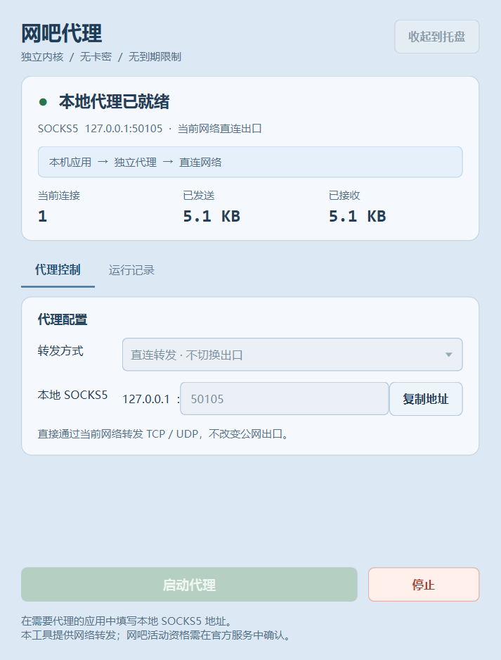

# 网吧代理 · 独立版

`netbar-proxy-independent` 是一个 Windows 桌面网络转发工具，包含重新编写的中文界面和 Python 代理内核。无需卡密、机器绑定或试用激活，没有到期限制。

本地入口为 **SOCKS5**，可使用当前网络直连，也可通过你自己的 SOCKS5、HTTP CONNECT 或 HTTPS CONNECT 服务器转发。程序不包含代理服务器账号、网吧认证或活动资格功能；启动代理不代表网吧活动已开启，也不会自动接管 PUBG 或其他应用的连接。

[下载最新版本](https://github.com/mfj1997/netbar-proxy-independent/releases/latest) · [使用说明](使用说明.txt) · [验证结果](验证结果.txt)



## 功能

- 启动、停止、托盘收起和恢复窗口。
- 实时显示活动连接数、发送和接收流量。
- 本地 SOCKS5 入口仅监听环回地址，默认 `127.0.0.1:10808`。
- 支持 IPv4、IPv6、域名目标，以及可选上游用户名密码认证。
- 上游连接检测区分配置、传输和认证，不把监听成功当作转发成功。
- 配置文件只保存服务器、端口等非敏感设置，用户名和密码仅留在当前会话内。
- 不依赖原程序的 EXE、Xray、腾讯网吧客户端、账户配置或卡密文件。

| 转发方式 | TCP | UDP | 说明 |
| --- | --- | --- | --- |
| 直连 | 支持 | 支持 | 使用当前网络，不改变公网出口 |
| SOCKS5 上游 | 支持 | 上游需支持 UDP ASSOCIATE | 可选用户名密码认证 |
| HTTP CONNECT 上游 | 支持 | 不支持 | 可选 Basic 认证 |
| HTTPS CONNECT 上游 | 支持 | 不支持 | TLS 连接并校验证书及主机名 |

本地入口始终是 SOCKS5。HTTP/HTTPS 选项表示上游服务器的类型。未实现 SOCKS5 BIND、UDP 分片或 GSSAPI。

## 下载使用

1. 从 [Releases](https://github.com/mfj1997/netbar-proxy-independent/releases/latest) 下载完整压缩包并解压。
2. 双击 `网吧代理独立版.exe`，无需安装 Python。
3. 选择转发方式。使用远端代理时，填写你自己的服务器和认证信息。
4. 点击“启动代理”，在需要代理且支持 SOCKS5 的应用中填写 `127.0.0.1` 和界面显示的端口。
5. 点击“停止”关闭本工具的转发连接。关闭窗口会退出；“收起到托盘”会继续运行。

已在 Windows 11 64 位验证。直连模式可以直接使用，但不会切换网络出口。本工具不修改系统代理，不注入或修改游戏进程。

普通 SOCKS5 和 HTTP 协议本身不加密认证数据；需要加密上游链路时选择 HTTPS CONNECT。

## 从源码运行

使用 Python 3.13 64 位，在仓库根目录的 PowerShell 中执行：

```powershell
python -m venv .venv
.\.venv\Scripts\python.exe -m pip install -r source\requirements.txt
.\.venv\Scripts\python.exe source\app.py
```

源码运行时，非敏感设置保存在仓库根目录的 `config.json`。打包版本保存在 EXE 同目录。用户名和密码不会写入该文件。

## 运行测试

```powershell
.\.venv\Scripts\python.exe -m pip install -r tests\requirements-dev.txt
.\.venv\Scripts\python.exe -m unittest discover -s tests -p "test_*.py" -v
```

v1.0.0 的 31 项集成测试通过，覆盖真实本地 TCP/UDP 转发、SOCKS5/HTTP 认证上游、HTTPS 证书校验、认证失败、超时、端口占用、停止清理及配置不保存凭据。此外，4 项界面操作检查和打包后的启动检查通过。

测试仅使用本机 TCP/UDP 服务和临时测试证书，不修改系统证书。未验证用户真实上游服务器、游戏连接、活动资格或奖励。

## 构建 EXE

在仓库根目录执行：

```powershell
.\source\build.ps1
```

脚本会创建独立的 `.build` 环境、安装固定版本依赖，并在仓库根目录生成 `网吧代理独立版.exe`。构建时会隔离 `PATH`，避免误带入其他软件的不兼容 ICU 或 CRT DLL。

## 项目结构

```text
source/
  app.py              中文桌面界面
  proxy_engine.py     SOCKS5 入口与上游转发
  service.py          后台线程与界面状态
  settings.py         配置校验及非敏感设置保存
  build.ps1           Windows 构建脚本
tests/                本地集成测试
licenses/             第三方运行时许可文本
```

## 许可

新编写的应用源代码使用 [MIT License](LICENSE.txt)。Python、PySide6/Qt、Shiboken6 和 PyInstaller 保留各自许可，见 [第三方声明](THIRD_PARTY_NOTICES.txt) 和 `licenses/`。
